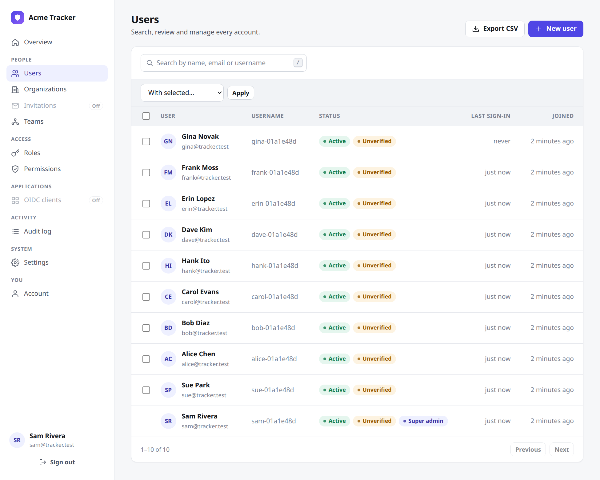
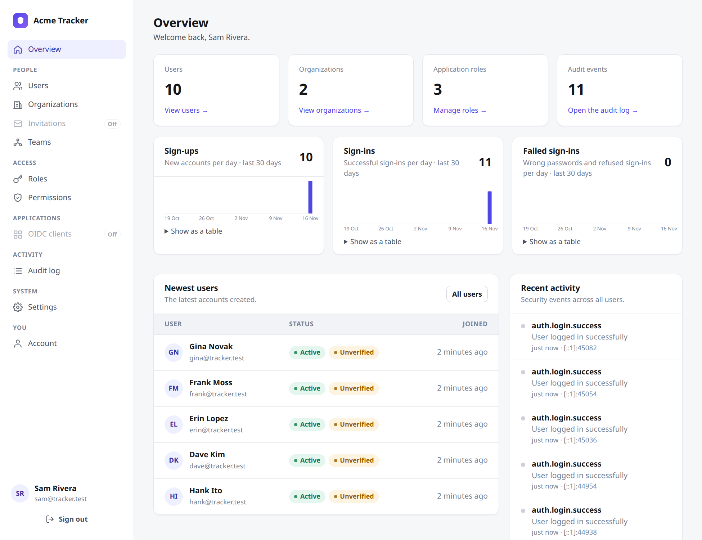
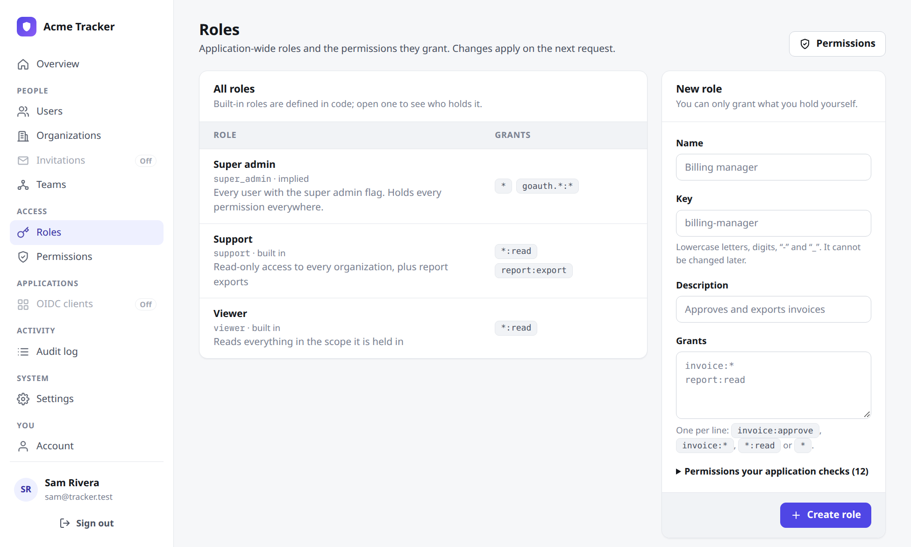

<div align="center">

# GoAuth

### Authentication library for Go (Golang): user accounts in your own app, without a separate auth server

Sign-up, login, password reset, 2FA, "Sign in with Google", passkeys, organizations, roles and an admin console.<br>
One Go library, inside your own server, on your own database.

[](https://pkg.go.dev/github.com/bete7512/goauth)
[](https://goreportcard.com/report/github.com/bete7512/goauth)
[](https://go.dev/)
[](LICENSE)

[Documentation](https://goauth.beteg.dev) · [Quick start](#quick-start) · [What you get](#what-you-get) · [Is it right for you?](#is-goauth-right-for-you) · [Modules](#modules) · [Examples](#examples)

</div>

---

## What is GoAuth?

Almost every app needs the same account features. People sign up, log in, forget their password, verify their email, turn on two-factor, sign in with Google. Later you need teams, roles, and a screen where support can look up a user.

GoAuth is a Go library that gives you those features ready-made. You add it to the server you already have:

1. **Give it a database.** PostgreSQL, MySQL or SQLite. GoAuth creates and migrates its own tables.
2. **Mount its routes.** Your router gains working endpoints such as `POST /auth/signup`, `POST /auth/login` and `GET /auth/me`.
3. **Protect your own routes.** Wrap a handler in `a.RequireAuth(...)` and read the signed-in user from the request.

```
               your Go server (one binary)
┌────────────────────────────────────────────────────────┐
│  your routes                  GoAuth's routes          │
│  GET  /api/orders             POST /auth/signup        │
│  POST /api/invoices           POST /auth/login         │
│        │                      GET  /auth/me    ...     │
│        └─ a.RequireAuth(handler)                       │
└────────────────────────────┬───────────────────────────┘
                             │
             your PostgreSQL, MySQL or SQLite
```

There is no extra service to deploy, no third party holding your users, and no price per user. Your frontend (React, a mobile app, anything that speaks HTTP) calls the endpoints, and your Go code stays in charge.

If you have used Devise in Rails or Better Auth in TypeScript, GoAuth is the same kind of thing for Go.

## What you get

You start with sign-up and login. Everything else is a module you switch on with one line when you need it.

| | |
|---|---|
| **Signing in** | Email and password · magic links and emailed codes · Google, GitHub, Microsoft and Discord, plus providers you add in code · passkeys (Touch ID, Face ID, security keys) · SAML single sign-on |
| **Account basics** | Email and phone verification · forgot and reset password · change password · profile |
| **Keeping accounts safe** | Authenticator-app 2FA with backup codes · rate limiting · account lockout · captcha · CSRF protection · audit log |
| **Staying signed in** | JWT access tokens with rotating refresh tokens, or server-side sessions with a device list users can revoke |
| **Teams and permissions** | Organizations with members and invitations · nested teams · roles and permission checks for your own routes |
| **Administration** | A built-in admin console and an admin API |
| **Being the login for other apps** | "Sign in with YourApp" through OpenID Connect |
| **Plumbing** | Email and SMS delivery (Resend, SendGrid, SMTP, Twilio) · events you can hook into · an OpenAPI spec · a generated TypeScript client |

Some of these are newer than the latest tagged beta. The [modules table](#modules) says which.

### The admin console is included

<a href="https://goauth.beteg.dev/docs/modules/ui">
  
</a>

Register the `ui` module and super admins can search users, ban or unlock accounts, reset 2FA, manage organizations, teams, roles and OIDC clients, and read the audit log. The pages are rendered on the server and embedded in the library, so there is no Node toolchain and no build step.

<details>
<summary>More screenshots</summary>
<br>





</details>

The screenshots come from [`examples/rbac`](examples/rbac), which you can run yourself:

```bash
git clone https://github.com/bete7512/goauth && cd goauth/examples
go run ./rbac
# open http://localhost:8080/admin/login and sign in as sam@tracker.test / Tracker-demo-1
```

## Quick start

A complete program. It uses SQLite, so you only need Go 1.26+ and a C compiler (the SQLite driver uses cgo).

```bash
mkdir hello-auth && cd hello-auth
go mod init hello-auth
go get github.com/bete7512/goauth@v0.3.0-beta.1
```

`main.go`:

```go
package main

import (
	"context"
	"fmt"
	"log"
	"net/http"

	"github.com/bete7512/goauth/pkg/adapters/stdhttp"
	"github.com/bete7512/goauth/pkg/auth"
	"github.com/bete7512/goauth/pkg/config"
	"github.com/bete7512/goauth/pkg/types"
	"github.com/bete7512/goauth/storage"
)

func main() {
	// 1. Give GoAuth a database.
	store, err := storage.NewGormStorage(storage.GormConfig{
		Dialect: types.DialectTypeSqlite,
		DSN:     "auth.db",
	})
	if err != nil {
		log.Fatal(err)
	}

	// 2. Configure it.
	a, err := auth.New(&config.Config{
		Storage:   store,
		BasePath:  "/auth",
		Migration: config.MigrationConfig{Auto: true}, // create the tables at startup
		Core:      &config.CoreConfig{},
		Security: types.SecurityConfig{
			JwtSecretKey:  "change-me-to-a-32-char-secret!!!",
			EncryptionKey: "change-me-to-a-32-char-key!!!!!!",
			// Cookies are Secure by default; allow plain HTTP only on localhost.
			Session: types.SessionConfig{AllowInsecureCookies: true},
		},
	})
	if err != nil {
		log.Fatal(err)
	}
	defer a.Close()

	// 3. Start it. Optional modules go in a.Use(...) calls before this line.
	if err := a.Initialize(context.Background()); err != nil {
		log.Fatal(err)
	}

	// 4. Mount GoAuth's routes next to your own.
	mux := http.NewServeMux()
	mux.Handle("GET /hello", a.RequireAuth(http.HandlerFunc(hello)))

	log.Fatal(http.ListenAndServe(":8080", stdhttp.Register(mux, a)))
}

// hello only runs for signed-in users.
func hello(w http.ResponseWriter, r *http.Request) {
	user, _ := types.PrincipalFromContext(r.Context())
	fmt.Fprintf(w, "hello, %s\n", user.UserID)
}
```

```bash
go mod tidy
go run .
```

In another terminal:

```bash
# 1. Create an account
curl -X POST localhost:8080/auth/signup \
  -d '{"email":"ada@example.com","password":"S3cure-pass!"}'
# 201  {"data":{"user":{"id":"01a1e48d-…","email":"ada@example.com",…},"message":"Signup successful. Please login to continue."}}

# 2. Log in
curl -X POST localhost:8080/auth/login \
  -d '{"email":"ada@example.com","password":"S3cure-pass!"}'
# 200  {"data":{"access_token":"eyJ…","refresh_token":"eyJ…","expires_in":900,"user":{…}}}

# 3. Call your own route with the access token
curl localhost:8080/hello -H "Authorization: Bearer <access_token>"
# 200  hello, 01a1e48d-38f0-7050-a3fa-3338586fea0e

# ...and without it
curl localhost:8080/hello
# 401  {"data":{"code":"UNAUTHORIZED","message":"invalid access credential"}}
```

You registered no modules, so GoAuth used its defaults: **Core** (accounts, passwords, verification), **Stateless** (JWT access tokens and rotating refresh tokens) and the **rate limiter**. That already gives you 17 endpoints:

| Endpoint | What it does |
|---|---|
| `POST /auth/signup` | Create an account |
| `POST /auth/login` · `POST /auth/logout` · `POST /auth/refresh` | Sign in, sign out, trade a refresh token for a new pair |
| `GET /auth/me` · `PUT /auth/profile` | Read and update the signed-in user |
| `PUT /auth/change-password` | Change the password |
| `POST /auth/forgot-password` · `POST /auth/reset-password` | Recover a forgotten password |
| `POST /auth/send-verification-email` · `GET /auth/verify-email` | Verify an email address (plus a resend route) |
| `POST /auth/send-verification-phone` · `POST /auth/verify-phone` | Verify a phone number (plus a resend route) |
| `POST /auth/is-available` | Check whether an email, username or phone is taken |
| `GET /auth/.well-known/jwks.json` | Public keys, when you sign tokens with RS256 or ES256 |

Verification and reset emails go out once you add the Notification module. Without it, the `send.*` events still fire and you can deliver the messages yourself.

The [Quick Start guide](https://goauth.beteg.dev/docs/quickstart) has the production-shaped version: secrets from the environment, graceful shutdown, and the rest of the API.

## Is GoAuth right for you?

There are three usual ways to add accounts to a Go app. GoAuth is a fourth.

| | What you run | Where users live | What it costs you |
|---|---|---|---|
| **Hosted service** (Auth0, Clerk, WorkOS) | Nothing | The vendor's cloud | Usually a price per active user |
| **Identity server** (Keycloak, Ory, Zitadel) | A second service and its database | That service | Deploying, upgrading and monitoring it |
| **Write it yourself** (bcrypt and a JWT library) | Your app | Your database | Your time, and every edge case is yours |
| **GoAuth** | Your app | Your database | Free (MIT), and you keep its version up to date |

**GoAuth fits when**

- your backend is Go, and you want accounts in the same binary and the same database: one deploy, plain SQL joins against the `users` table, and SQLite for local development;
- you want to own your user data and not pay per user;
- you have your own frontend and want a JSON API for it, with an OpenAPI spec and a TypeScript client;
- you only need login today, but expect 2FA, single sign-on, organizations or roles later and would rather not switch systems to get them.

**Pick something else when**

- you need a frozen 1.0 API today. GoAuth is in beta, and a release can still contain breaking changes (they are always listed first in the [CHANGELOG](CHANGELOG.md));
- you need a vendor with an audit report, compliance certificates or an SLA. GoAuth has not had an independent security audit, and it is maintained by one developer;
- your services are not written in Go and you want one central login for all of them. A standalone identity server suits that better. GoAuth can act as an OpenID Connect provider for other apps, but that module is experimental;
- you want polished hosted login pages with no frontend work. GoAuth is API-first; the console's sign-in and account pages are plain and functional;
- your database is not PostgreSQL, MySQL or SQLite. Storage is an interface (`types.Storage`), but you would write the implementation.

The [comparison page](https://goauth.beteg.dev/docs/comparison) goes through Goth, Authboss, Ory Kratos, Keycloak and hosted services one by one.

## Security defaults

"Write it yourself" usually goes wrong in the details, not in the login handler. These are on without any configuration:

- **Passwords** are hashed with bcrypt, and the policy is 8 to 72 bytes.
- **Brute force:** requests are rate limited per IP and per account identifier, and an account locks for 15 minutes after 5 wrong passwords.
- **No account probing:** a locked account, a wrong password and an unknown email all get the same answer and cost the same hashing time.
- **A leaked database yields nothing to redeem:** reset, verification, magic-link and invitation tokens, short codes and refresh tokens are stored only as digests.
- **Refresh tokens rotate.** A used one cannot be used again, and two requests racing with the same token have exactly one winner.
- **Revocation is immediate.** A password change, ban, suspension or revoked session takes effect on the next request, not when the token expires.
- **2FA:** each TOTP code is accepted once. TOTP secrets, passkey data and stored OAuth provider tokens are encrypted with AES-256-GCM.
- **Cookies** are `Secure` and `HttpOnly` unless you opt out for local development.
- **OAuth:** PKCE is always used, the state is bound to the browser, and ID tokens are checked for signature, issuer, audience and nonce.
- **Misconfiguration stops startup.** An unprotected route, a route collision or an invalid signing key is an error before the server starts, not a warning in the logs.

The project's checks: golangci-lint and govulncheck, unit tests, over 200 integration tests that run whole flows end to end, and storage contract tests against real PostgreSQL and MySQL.

What it does not have yet is a third-party audit. Read the [security guide](https://goauth.beteg.dev/docs/security) and the [production checklist](https://goauth.beteg.dev/docs/production) before real users sign in, and report vulnerabilities privately as described in [SECURITY.md](SECURITY.md).

## Modules

Each module brings its own routes, tables, migrations and OpenAPI spec.

| Module | What it adds | Stability | Released |
|---|---|---|---|
| **Signing in** | | | |
| [Core](https://goauth.beteg.dev/docs/modules/core) | Sign-up, profile, password reset and change, email and phone verification. Always on. | Stable | ✓ |
| [Stateless](https://goauth.beteg.dev/docs/modules/stateless) | JWT access tokens and rotating refresh tokens. The default. | Stable | ✓ |
| [Session](https://goauth.beteg.dev/docs/modules/session) | Server-side sessions, sliding expiry, listing and revoking devices. | Stable | ✓ |
| [OAuth](https://goauth.beteg.dev/docs/modules/oauth) | Google, GitHub, Microsoft and Discord with PKCE. Other providers through `oauth.NewWithProviders`. | Stable | ✓ |
| [Magic Link](https://goauth.beteg.dev/docs/modules/magiclink) | Passwordless login by emailed link or 6-digit code. | Stable | ✓ |
| [Passkeys](https://goauth.beteg.dev/docs/modules/passkeys) | WebAuthn login with Touch ID, Face ID, Windows Hello or security keys. | Experimental | ✓ |
| [SAML](https://goauth.beteg.dev/docs/modules/saml) | SAML 2.0 service provider for Keycloak, Okta, Entra ID and other enterprise identity providers. | Experimental | `main` |
| **Protecting accounts** | | | |
| [Two-Factor](https://goauth.beteg.dev/docs/modules/twofactor) | TOTP authenticator apps and backup codes. | Stable | ✓ |
| [Rate Limit](https://goauth.beteg.dev/docs/modules/ratelimit) | Per-IP and per-identifier budgets on login, sign-up, verification, resets and sends. On by default, with a pluggable store for several replicas. | Stable | ✓ |
| [Captcha](https://goauth.beteg.dev/docs/modules/captcha) | reCAPTCHA v3 or Cloudflare Turnstile on the routes you choose. | Stable | ✓ |
| [CSRF](https://goauth.beteg.dev/docs/modules/csrf) | Double-submit cookie protection for state-changing requests. | Stable | ✓ |
| [Audit](https://goauth.beteg.dev/docs/modules/audit) | A security event trail: logins, password changes, admin actions. | Stable | ✓ |
| **Organizations and access** | | | |
| [Organization](https://goauth.beteg.dev/docs/modules/organization) | Multi-tenant organizations with members, roles, invitations and switching. | Experimental | ✓ |
| [Team](https://goauth.beteg.dev/docs/modules/team) | Nested teams inside organizations, up to five levels. Leads manage their sub-tree. | Experimental | `main` |
| [RBAC](https://goauth.beteg.dev/docs/modules/rbac) | Roles and permission checks for your own routes and services: application-wide, per organization or per team. | Experimental | `main` |
| [Invitation](https://goauth.beteg.dev/docs/modules/invitation) | Platform-wide invitations, such as beta access and referrals, for apps without organizations. | Experimental | ✓ |
| **Administration** | | | |
| [Admin](https://goauth.beteg.dev/docs/modules/admin) | User management endpoints for super admins. | Experimental | ✓ |
| [UI](https://goauth.beteg.dev/docs/modules/ui) | The admin console above, plus optional sign-in and account pages for every user. | Stable | `main` |
| **Connecting** | | | |
| [Notification](https://goauth.beteg.dev/docs/modules/notification) | Email and SMS through Resend, SendGrid, SMTP or Twilio, with branded templates. | Stable | ✓ |
| [Identity Provider](https://goauth.beteg.dev/docs/modules/idp) | OpenID Connect provider: other applications sign users in with your accounts, on a built-in sign-in and consent page. | Experimental | `main` |

- **Experimental** modules work and are tested, but their API and schema may change during the beta.
- **Released ✓**: in `v0.3.0-beta.1`. **`main`**: merged, waiting for the next beta. To try one now: `go get github.com/bete7512/goauth@main`.
- **Session and Stateless are mutually exclusive.** Choose one, or register neither and get Stateless.

### Adding modules

A module is one `Use()` call before `Initialize()`. `Use()` returns an error when a module is registered twice, conflicts with another or is missing a dependency, so check it.

```go
must := func(err error) {
	if err != nil {
		log.Fatal(err)
	}
}

// Send real emails
must(a.Use(notification.New(&notification.Config{
	EmailSender: senders.NewResendEmailSender(&senders.ResendConfig{
		APIKey:      os.Getenv("RESEND_API_KEY"),
		DefaultFrom: "hello@yourapp.com",
	}),
	EnableWelcomeEmail: true,
})))

// "Sign in with Google" (also set APIURL in the config; it builds the callback URL)
must(a.Use(oauth.New(&config.OAuthModuleConfig{
	Providers: map[string]*config.OAuthProviderConfig{
		"google": {ClientID: "...", ClientSecret: "...", Enabled: true},
	},
	DefaultRedirectURL: "https://app.yourapp.com/auth/callback",
	AllowSignup:        true,
})))

// Authenticator-app 2FA
must(a.Use(twofactor.New(&config.TwoFactorConfig{Issuer: "YourApp"})))

// The admin console at /admin
must(a.Use(ui.New(&ui.Config{Path: "/admin"})))

// Roles and permissions for your own routes
authz := rbac.New(&rbac.Config{
	Roles: []rbac.Role{
		{Key: "viewer", Grants: []string{"*:read"}},
		{Key: "accountant", Grants: []string{"invoice:*"}},
	},
})
must(a.Use(authz))

must(a.Initialize(ctx))

mux.Handle("POST /invoices/{id}/approve",
	a.RequireAuth(authz.Require("invoice:approve")(http.HandlerFunc(approve))))
```

Bundled modules are imported from `github.com/bete7512/goauth/pkg/modules/<name>`. Each one has a page on the [docs site](https://goauth.beteg.dev) with its configuration, endpoints and errors.

## Works with your router

```go
stdhttp.Register(mux, a)          // net/http
ginadapter.Register(router, a)    // Gin
chiadapter.Register(router, a)    // Chi
fiberadapter.Register(app, a)     // Fiber
```

`stdhttp` ships with GoAuth. The Gin, Chi and Fiber adapters are separate Go modules, so GoAuth never pulls a framework you do not use:

```bash
go get github.com/bete7512/goauth/pkg/adapters/ginadapter@v0.3.0-beta.1
```

Using something else? `a.Routes()` returns method, path and handler for every route, and you can mount them anywhere.

## Hook into events

React to what happens without forking anything:

```go
a.On(types.EventAfterSignup, func(ctx context.Context, e *types.Event) error {
	// start a trial, sync to your CRM, post to Slack...
	return nil
})
```

`before.*` hooks run inline and can reject the operation. `after.*` hooks run on a built-in worker pool. With several instances, pass your own `types.AsyncBackend` (NATS, Redis, Kafka); [`examples/nats_backend.go`](examples/nats_backend.go) is a NATS JetStream one.

## Storage and migrations

```go
store, err := storage.NewGormStorage(storage.GormConfig{Dialect: types.DialectTypePostgres, DSN: dsn})

store := storage.NewGormStorageFromDB(existingGormDB) // or reuse your own connection
```

Migrations are embedded per module and per database. Apply them at startup, or write them out as SQL files to review and run yourself:

```go
Migration: config.MigrationConfig{
	Auto:      true,           // apply pending migrations at startup
	OutputDir: "./migrations", // and/or write up/down SQL files
}
```

A different database means implementing `types.Storage`. See [Storage](https://goauth.beteg.dev/docs/storage) and [Migrations](https://goauth.beteg.dev/docs/migrations).

## Token signing and JWKS

HS256 is the default. Switch to RS256 or ES256 when other services need to verify tokens without sharing a secret:

```go
Security: types.SecurityConfig{
	JWTAlgorithm:      types.JWTAlgorithmRS256,
	JWTPrivateKeyFile: "/etc/goauth/jwt.key",
	// ...
}
```

The public keys are then served at `{BasePath}/.well-known/jwks.json`. Every token carries a `kid`, so rotating a key is a configuration change.

## TypeScript client

Every module ships an OpenAPI spec, and a typed fetch client is generated from them:

```bash
make sdk
```

The client is built from this repository and is not on npm yet. See [`clients/ts`](./clients/ts).

## Write your own module

A module is any type that implements `config.Module`: a name, routes, middlewares, hooks, migrations and an OpenAPI spec. Yours gets the same storage, events, logger and security manager as the bundled ones.

```go
var _ config.Module = (*BillingModule)(nil)

a.Use(&BillingModule{})
```

The [core module](internal/modules/core/module.go) is the reference implementation.

## Examples

| | |
|---|---|
| [`examples/rbac`](examples/rbac) | "Acme Tracker": organizations, nested teams, every kind of permission check, and the admin console. Runs in memory with one command. |
| [`examples/idp`](examples/idp) | GoAuth as an OpenID Connect provider, with scripts that test it against Grafana and oauth2-proxy. |
| [`examples/main.go`](examples/main.go) | One server using most modules, with PostgreSQL and a NATS event backend. |
| [`demo/`](demo) | A Next.js frontend that talks to the API. |

## Development

```bash
make build              # compile everything
make test               # unit tests
make test-integration   # whole flows against in-memory SQLite
make test-bench         # benchmarks
make lint               # golangci-lint
make mocks              # regenerate mocks
make check              # everything CI runs except the database contract tests
```

```
pkg/        public API: auth, config, types, modules, adapters
internal/   module implementations, events, security
storage/    GORM backend and cache decorators
clients/ts  generated TypeScript client
examples/   runnable example servers
demo/       Next.js demo app
docs/       documentation site
```

Contributions are welcome. [CONTRIBUTING.md](CONTRIBUTING.md) covers tooling, conventions and the release steps.

## Project status

GoAuth is in **public beta**. `v0.3.0-beta.1` (October 2026) is the first release of the current line.

- Install the beta by version, as the quick start does. A plain `go get` picks the newest non-beta release, and every release before 0.3.0 is retracted because of known security issues.
- Before 1.0, a release may contain breaking changes. The [CHANGELOG](CHANGELOG.md) lists them first, and the [upgrade guide](docs/docs/upgrade.md#upgrading-from-v02x) covers moving from v0.2.x.
- The SAML, Identity Provider, RBAC, Team and UI modules are on `main` and will be in the next beta.
- What is left for the beta is tracked in the [First beta release](https://github.com/bete7512/goauth/milestone/1) milestone.

If you try it and something is confusing, broken or missing, please [open an issue](https://github.com/bete7512/goauth/issues). That feedback is what moves the project toward 1.0.

## License

MIT. See [LICENSE](LICENSE).
