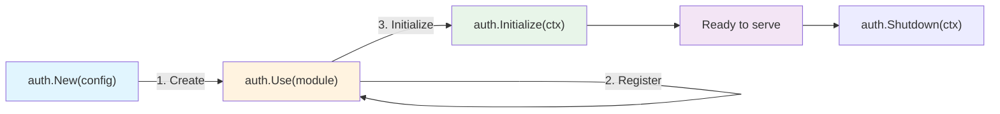
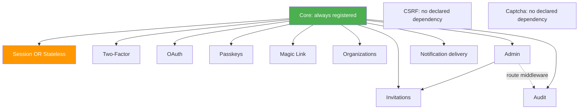
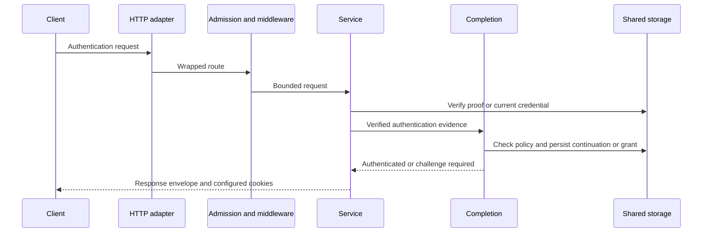
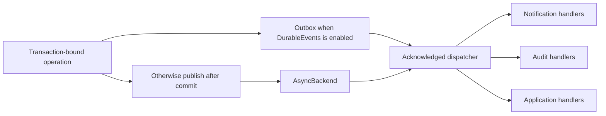
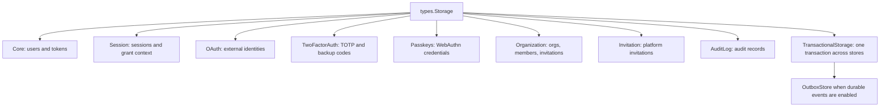
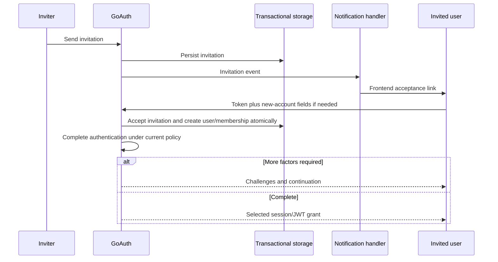
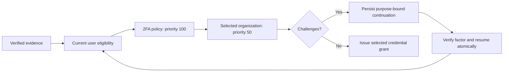

# Architecture

GoAuth is a library embedded in your Go process. Modules share configuration, storage, events, middleware, and an authentication completion service. The public entry points live in `pkg/`; application integrations do not import `internal/`.

## Repository Structure

```text
pkg/auth/           Lifecycle, routes, in-process sign-in, migrations, OpenAPI
pkg/config/         Config, Component, Module, composition contracts
pkg/types/          Public security, storage, events, principal and grant types
pkg/models/         Persistence models and repository interfaces
pkg/modules/        Public constructors for built-in modules
pkg/adapters/       net/http plus separately versioned Gin/Chi/Fiber adapters
internal/authentication/  Shared completion and challenge resumption
internal/operation/       Transaction-bound security operations and events
internal/modules/         Built-in handlers, services, migrations and OpenAPI
internal/security/        Signing, encryption, credentials and current-state checks
storage/gorm/       SQL repositories, transactions, migration locks and outbox
docs/               Next.js + Fumadocs website; authored guides in docs/docs/
```

## Three-Phase Lifecycle



### Phase 1: `auth.New(config)`

Validates and snapshots configuration, creates shared services, and registers Core. `Config()` returns a copy. New instances cannot serve protected routes until initialization completes.

### Phase 2: `auth.Use(module)`

Registers a `config.Component` and returns an error for invalid/duplicate names, conflicting Session/Stateless strategies, or registration after initialization. These are errors, not panics.

### Phase 3: `auth.Initialize(ctx)`

Selects default Stateless when needed, validates the complete composition graph, resolves credential stores, sets up shared completion, applies/exports migrations, and initializes modules in dependency order. It validates the completed route/middleware table before starting event consumption and marking the instance ready.

Failed initialization cleans up started resources. Shutdown reverses module order and then closes backend/storage resources. See [Lifecycle](api/auth.md) for the API and storage ownership.

## Module Contract

The minimum extension contract has two methods:

```go
type Component interface {
    Name() string
    Init(context.Context, config.ModuleDependencies) error
}
```

This is the shape of `config.Component`; `Auth.Use` accepts it directly. The original eight-method `config.Module` contract remains supported. For a minimal component, routes, middleware, hooks, dependencies, OpenAPI, migrations, shutdown, and constraints are optional capabilities detected by the adapter.

```go
type ModuleConstraints struct {
    Provides  []string
    Requires  []string
    Conflicts []string
}
```

`Constraints()` advertises capabilities, required capabilities, and conflicting **module names**. Required providers initialize before consumers. Missing providers/dependencies, duplicate providers, cycles, and conflicts cause initialization errors. Optional `Shutdown(context.Context) error` participates in reverse-order cleanup.

Dependencies supplied to a module include `Storage`, `Config`, `Logger`, `Events`, `MiddlewareManager`, `SecurityManager`, `AuthInterceptors`, and `Completion`. Submit verified evidence to `Completion`; never populate trusted authentication evidence directly from an unverified request body.

## Module Dependency Graph



Module names alone do not cover every requirement. Storage capabilities and referenced middleware must also exist. Invitation declares Admin as a dependency. Audit declares Core, but its admin routes also require Admin’s middleware. Notification exposes no HTTP endpoints.

## Request Flow



Protected access goes through online validation: cryptographic checks, credential purpose, user/version/eligibility, session validity when applicable, and selected-organization membership. The `Principal` placed in context represents that verified result. Signature-only parsing is not the built-in authorization boundary.

### Middleware Priority

Higher priorities run first. Core authentication uses priority 50; organization and session-cache middleware use 45; the Two-Factor route middleware uses 40. Its current body is a pass-through: factor enforcement is in the completion interceptor, not per-route step-up middleware. Route requirements are validated at initialization so missing protection is an error.

## Event System



The default backend uses ten workers and a bounded queue of 1000. A custom `types.AsyncBackend` can supply transport; `types.AcknowledgingBackend` adds retry-aware dispatch acknowledgement. Durable operation events and `authentication.completed` use the colocated outbox. Delivery is at least once; stable event IDs help consumers deduplicate. See [Events and deployment](enterprise.md) for the exact scope.

## Storage Architecture



`StorageSet` composes feature stores; it does not provide aggregate atomicity by itself. Refresh and continuation flows require conditional repository capabilities, and cross-feature security operations require transaction-bound stores. See [Storage contracts](storage.md) and [Models](api/models.md).

## Migration System

Each schema-owning module embeds versioned SQL per dialect. The runner applies dependency order followed by version order, coordinates concurrent runners, and records checksums. Dirty records and changed recorded SQL block automatic startup. PostgreSQL/SQLite support transactional recording; MySQL marks records dirty around DDL.

See [Migration management](migrations.md) for SQL generation, external-runner bookkeeping, and inactive-instance rollback.

## Invitation Flow (Complete)



Acceptance is public because the invitation token is the proof. Existing users omit new-account fields. Acceptance mutation and subsequent HTTP authentication completion are distinct steps: do not describe every failure after acceptance as an unconsumed invitation. A 2FA challenge can follow a successful acceptance.

## Auth Interceptors



Interceptors run in deterministic priority order and can add non-reserved claims or response data. Challenges are honored during login, refresh, and resume. Identity/assurance claims are reserved. The organization interceptor enriches the **selected** organization after checking current membership; it does not put every membership in a token or select an organization automatically.

## Service Pattern

Built-in modules separate HTTP DTOs/handlers from service logic and persistence. `Auth.SignIn` exposes password sign-in without HTTP, and `Auth.Authenticate` returns a verified principal. Custom transports deliver credentials themselves. Extension services use the shared completer so successful proof does not skip current policy or factor requirements.
