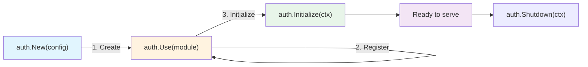
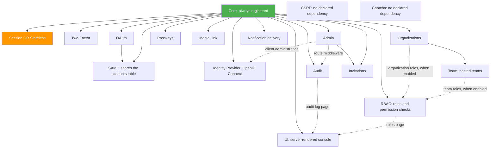
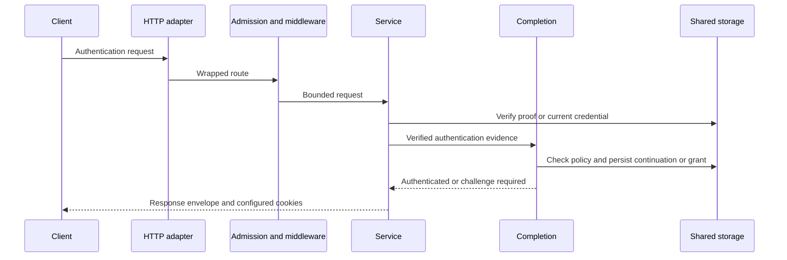
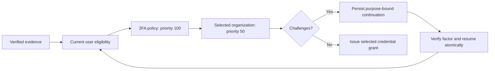
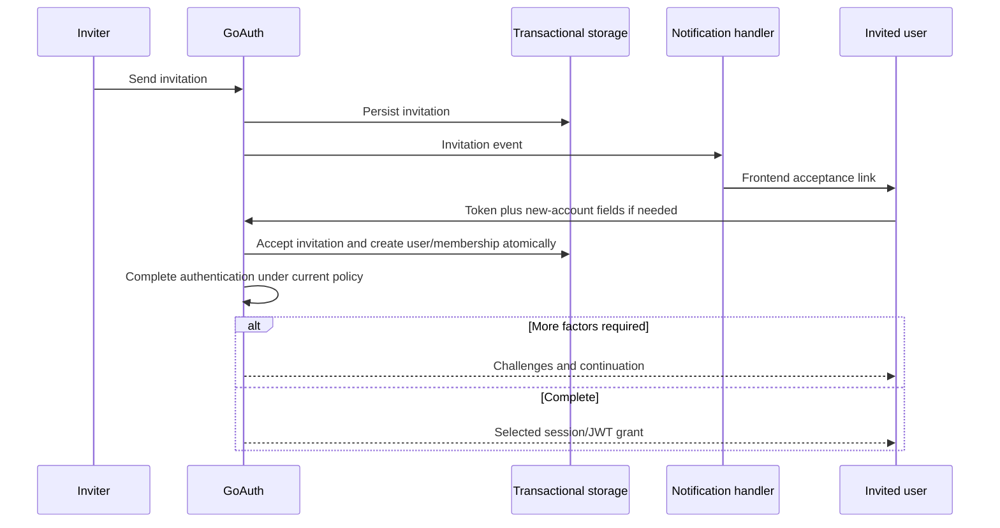
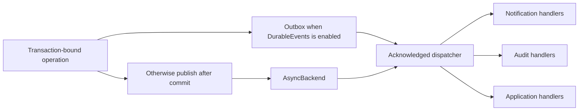
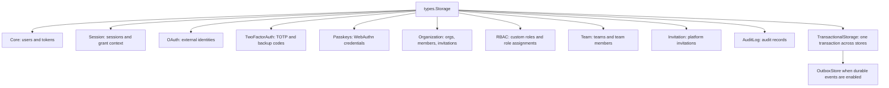

# Architecture

This page is for people who want to know how GoAuth works inside: to write a module, to write storage, or to judge the design. To use GoAuth, the [Introduction](intro.md) is enough.

## The big picture

GoAuth runs inside your Go process. It is a set of modules around a small core, and every module shares five things:

- **Configuration**, checked once and then frozen.
- **Storage**, one typed interface over your database.
- **Events**, so modules react to each other without importing each other.
- **Middleware**, such as the check that a request is signed in.
- **Completion**, the single path every sign-in goes through before credentials are issued.

Applications import only from `pkg/` and `storage/`. Everything under `internal/` is private.

## Where the code lives

```text
pkg/auth/           Lifecycle, routes, in-process sign-in, migrations, OpenAPI
pkg/config/         Config, Component, Module, composition contracts
pkg/types/          Public security, storage, events, principal and grant types
pkg/models/         Persistence models and repository interfaces
pkg/modules/        Public constructors for built-in modules
pkg/adapters/       net/http plus separately versioned Gin/Chi/Fiber adapters
internal/authentication/  Shared completion and challenge resumption
internal/operation/       Transaction-bound security operations and events
internal/modules/         Built-in handlers, services, migrations and OpenAPI
internal/security/        Signing, encryption, credentials and current-state checks
storage/gorm/       SQL repositories, transactions, migration locks and outbox
docs/               Next.js + Fumadocs website; authored guides in docs/docs/
```

## Lifecycle



**1. `auth.New(config)`** validates the configuration, snapshots it, creates the shared services and registers Core. Later changes to your config struct have no effect, and `Config()` returns a copy.

**2. `auth.Use(module)`** registers one component. It returns an error, never a panic, for an invalid or duplicate name, for both Session and Stateless, and for registering after initialization.

**3. `auth.Initialize(ctx)`** does the rest, in this order:

1. Adds Stateless if no strategy was chosen.
2. Checks that the set of modules is complete and consistent.
3. Decides which store holds credentials and sets up the shared sign-in path.
4. Applies or exports migrations, if configured.
5. Initializes modules in dependency order.
6. Checks every route and its middleware.
7. Starts event delivery and marks the instance ready.

If a step fails, everything already started is cleaned up, and you create a new instance to try again. `Shutdown` stops modules in reverse order, then closes the event backend and the storage. See the [Auth reference](api/auth.md).

## Modules

### The contract

The smallest thing `Use` accepts has two methods:

```go
type Component interface {
    Name() string
    Init(context.Context, config.ModuleDependencies) error
}
```

That is `config.Component`. Everything else is optional and detected when present: routes, middleware, hooks, dependencies, an OpenAPI spec, migrations, `Shutdown(context.Context) error`, and constraints. The eight-method `config.Module` interface still works.

### Saying what a module needs

```go
type ModuleConstraints struct {
    Provides  []string
    Requires  []string
    Conflicts []string
}
```

`Constraints()` lists the capabilities a module provides, the ones it requires, and the **names of modules** it cannot run beside. Providers start before the modules that need them. A missing provider, a duplicate provider, a cycle or a conflict stops initialization.

### What a module receives

`Init` gets `Storage`, `Config`, `Logger`, `Events`, `MiddlewareManager`, `SecurityManager`, `AuthInterceptors` and `Completion`.

One rule matters most: a module that signs users in hands **verified** evidence to `Completion`. It never fills in trusted sign-in data straight from a request body.

### How the bundled modules depend on each other {#module-dependency-graph}



A solid arrow is a declared dependency. A dotted arrow is needed only for the feature named on it. The stores a module uses and the middleware its routes name must exist too: Audit declares only Core, but its admin routes need Admin's middleware. Notification has no HTTP endpoints.

## What happens on a request



A protected route does more than check a signature. GoAuth verifies the token, checks that it is an access credential, then reads storage to confirm the user is still eligible and the token version is current. With sessions it also confirms the session is alive, and with a selected organization, the membership.

The `Principal` in the request context is the result of all of that. Parsing a JWT yourself and trusting its payload is not equivalent.

### Middleware order

Higher priority runs first: Core authentication is 50, organization and session-cache middleware 45, the Two-Factor route middleware 40. That last one currently passes requests through, because the second factor is enforced at sign-in, not per route. A route whose middleware is missing fails initialization, so it is never served unprotected by accident.

## One sign-in path



Every sign-in method proves identity in its own way, then submits that proof to the same completer. It checks that the account may sign in, runs the **auth interceptors** in priority order, and either issues credentials or stores a pending continuation and returns a challenge.

- Interceptors can add claims and response data, but the identity and assurance claims are reserved.
- Challenges are honored at login, at refresh and when resuming.
- The organization interceptor adds the **selected** organization after checking the membership. It does not put every membership in the token, and it does not pick an organization for the user.

### Example: accepting an invitation



Accepting is a public route, because the invitation token is the proof. An existing user leaves out the new-account fields. Accepting and signing in are two separate steps: the invitation can be accepted and the sign-in can still answer with a 2FA challenge, so a failure after acceptance does not mean the invitation is unused.

## Events



By default, events are delivered by an in-memory pool of ten workers with a queue of 1000.

- Replace the transport with your own `types.AsyncBackend`; add `types.AcknowledgingBackend` for retries that wait for an acknowledgement.
- With `DurableEvents`, `authentication.completed` and the events of security operations that run in a transaction are written to an outbox table together with the change they describe.
- Delivery is at least once. Events have stable IDs, so a consumer can ignore one it already handled.

See [Events and deployment](enterprise.md).

## Storage {#storage-architecture}



`types.Storage` gives each module a typed store, such as `Storage.Core()`.

Some operations change several stores at once: accepting an invitation creates a user and a membership. Those need `TransactionalStorage`, one transaction across all stores. `StorageSet` combines separate stores into one `Storage` but does not make them atomic. Refresh and resume also need repositories that update conditionally. See [Storage](storage.md) and the [Models reference](api/models.md).

## Migrations

Each module that owns tables embeds versioned SQL for every supported database. The runner applies modules in dependency order and versions in numeric order, takes a lock so two instances do not migrate at once, and records a checksum for each migration. A half-applied migration, or recorded SQL that no longer matches, blocks automatic startup. See [Migrations](migrations.md).

## Inside a module

Bundled modules keep three layers apart: HTTP handlers and their request types, service logic, and persistence. Handlers depend on a service interface.

`Auth.SignIn` exposes password sign-in without HTTP, and `Auth.Authenticate` turns a token into a verified principal, so another transport can reuse the same checks. A module of your own that signs users in should use the shared completer, so that proving identity never skips the account checks or the second factor.
