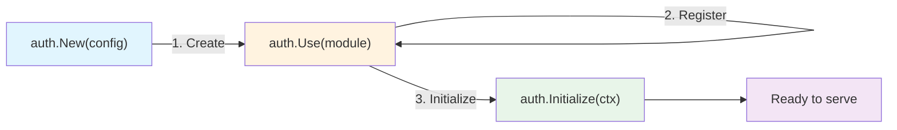

# GoAuth

GoAuth is a modular authentication library for Go. Start with signup and JWT credentials, or select server-side sessions. Add passkeys, OAuth, magic links, TOTP, organizations, and delivery modules to the same authentication pipeline.

These docs describe the current source checkout, including changes that may not yet be in a published release. See the [Upgrade guide](upgrade.md) when updating an existing integration.

## How It Works

1. `auth.New` validates and snapshots configuration and registers Core.
2. `a.Use` registers optional components. Check the returned error.
3. `a.Initialize` resolves dependencies, runs configured migrations, initializes modules, validates routes, and starts event delivery.
4. Register HTTP routes with an adapter. Shut down HTTP serving before `a.Shutdown(ctx)` or `a.Close()`.

The [Quick Start](quickstart.md) contains a complete program with error handling, environment-based secrets, migrations, and graceful shutdown.

## Available Modules {#available-modules}

| Module | Purpose | Registration |
|---|---|---|
| [Core](modules/core.md) | Signup, profile, password and verification flows | Automatic |
| [Session](modules/session.md) | Server-side sessions and device management | `session.New(...)` |
| [Stateless](modules/stateless.md) | JWT credentials with stored refresh nonces | Default if no strategy is selected |
| [Passkeys](modules/passkeys.md) | WebAuthn registration and discoverable login | `passkeys.New(...)` |
| [Two-Factor](modules/twofactor.md) | TOTP and backup codes | `twofactor.New(...)` |
| [OAuth](modules/oauth.md) | Google, GitHub, Microsoft, Discord; named connections | `oauth.New(...)` |
| [Magic Link](modules/magiclink.md) | Email links and verification codes | `magiclink.New(...)` |
| [Notification](modules/notification.md) | Event-driven email and SMS | `notification.New(...)` |
| [Organization](modules/organization.md) | Memberships, roles, organization invitations | `organization.New(...)` |
| [Invitation](modules/invitation.md) | Platform invitations; requires Admin | `invitation.New(...)` |
| [Admin](modules/admin.md) | Super-admin user management | `admin.New(...)` |
| [Audit](modules/audit.md) | Event logging and retention; admin routes need Admin | `audit.New(...)` |
| [Captcha](modules/captcha.md) | reCAPTCHA v3 and Turnstile | `captcha.New(...)` |
| [CSRF](modules/csrf.md) | CSRF cookie/header validation | `csrf.New(...)` |

Session and Stateless are mutually exclusive. Registration/initialization errors must be handled; invalid combinations do not intentionally panic. Both built-in strategies check current user state when validating access credentials. Stateless does not mean database-free.

## One completion flow

Password, OAuth, magic-link, passkey, and invitation authentication run through common eligibility and challenge checks. A successful proof may return `challenges` rather than final tokens. Complete the challenge before treating the user as signed in. Organization context and verified authentication methods survive refresh.

HTTP middleware creates a verified `types.Principal`. Applications outside HTTP can use `a.SignIn` and `a.Authenticate`. See the [Auth reference](api/auth.md) and [Security guide](security.md).

## Frameworks and storage

Use `stdhttp.Register(mux, a)` for the standard library. Gin, Chi, and Fiber adapters are separate Go modules; install the adapter you use as described in [Installation](installation.md).

The bundled GORM store supports PostgreSQL, MySQL, and SQLite. Custom stores implement repositories plus the required atomic and transactional capabilities. [Storage](storage.md) explains ownership, transaction boundaries, and refresh-token rotation.

## Events and deployment

Before hooks can reject an operation synchronously. After hooks normally run asynchronously in a worker pool. Durable operations use an outbox when enabled; handlers must tolerate repeated delivery. See [Enterprise deployment](enterprise.md), [Migrations](migrations.md), and [Performance](performance.md).
