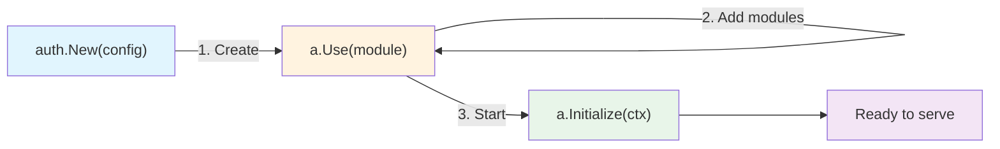

# Introduction

GoAuth is an authentication library for Go (Golang). This page explains how it works, so the rest of the docs make sense. To start with running code, go to the [Quick Start](quickstart.md) and come back.

## What GoAuth owns and what you own

GoAuth is a library that you compile into your own server.

| GoAuth owns | You own |
| --- | --- |
| The account endpoints under one path prefix (`BasePath`, for example `/auth`) | The HTTP server, the router and everything else it serves |
| Its tables and their migrations | The database and its connection |
| Checking who the caller is on each request | Deciding what that user may do in your app |
| Password hashing, tokens, sessions, lockout, rate limits | Your frontend: forms, pages and redirects |

A sign-up form on your site posts to `POST /auth/signup`. A page that needs a signed-in user calls your own route, which you wrapped in `a.RequireAuth(...)`.

## Three calls set it up



1. **`auth.New(config)`** checks your configuration and creates the instance. The Core module is added for you.
2. **`a.Use(module)`** adds an optional module. Check the error it returns.
3. **`a.Initialize(ctx)`** orders the modules by what they depend on, runs migrations if you asked for them, and starts everything. After it, `a.Use` returns an error.

Then an adapter such as `stdhttp.Register(mux, a)` hands the routes to your router. When your server stops, call `a.Shutdown(ctx)` or `a.Close()`.

## Two choices you make early

### How users stay signed in

Pick one. They cannot be registered together, and registering neither gives you Stateless.

| | [Stateless](modules/stateless.md) (the default) | [Session](modules/session.md) |
| --- | --- | --- |
| What the client holds | A JWT access token and a JWT refresh token | A JWT access token tied to a session, and an opaque refresh credential |
| What the server stores | A record for each refresh token | One row per session, so one per device |
| Good for | APIs, mobile apps, services | Apps where users see their devices and sign one out |
| Signing out | Ends all of the user's tokens | Ends that session; users can list and end the others |

"Stateless" does not mean "no database". Both strategies check the user's current state on every request, so a ban or a password change takes effect on the next request.

### How credentials travel

`Security.AuthMode` decides whether GoAuth reads credentials from cookies, from the `Authorization: Bearer` header, or from both (the default). This is separate from the choice above. See [Security](security.md#credential-transport).

## Available Modules {#available-modules}

Each module brings its own routes, tables, migrations and OpenAPI spec. You register one with `<name>.New(...)`, for example `twofactor.New(...)`.

| Module | What it adds | Needs |
| --- | --- | --- |
| [Core](modules/core.md) | Sign-up, profile, password reset and change, email and phone verification. Always on | |
| [Stateless](modules/stateless.md) | JWT access tokens and rotating refresh tokens. The default strategy | |
| [Session](modules/session.md) | Server-side sessions, device list and revoke | |
| [OAuth](modules/oauth.md) | Google, GitHub, Microsoft and Discord sign-in | |
| [Magic Link](modules/magiclink.md) | Sign-in by emailed link or 6-digit code | |
| [Passkeys](modules/passkeys.md) | WebAuthn sign-in with Touch ID, Face ID or security keys | |
| [SAML](modules/saml.md) | SAML 2.0 single sign-on with Keycloak, Okta, Entra ID | OAuth |
| [Two-Factor](modules/twofactor.md) | Authenticator-app codes and backup codes | |
| [Rate Limit](modules/ratelimit.md) | Request budgets per IP and per account. On by default | |
| [Captcha](modules/captcha.md) | reCAPTCHA v3 or Cloudflare Turnstile | |
| [CSRF](modules/csrf.md) | Protection for cookie-authenticated writes | |
| [Audit](modules/audit.md) | A security event trail with retention | Admin, for its admin routes |
| [Organization](modules/organization.md) | Organizations with members, roles and invitations | |
| [Team](modules/team.md) | Nested teams inside organizations | Organization |
| [RBAC](modules/rbac.md) | Roles and permission checks for your own routes | Organization, for organization roles |
| [Invitation](modules/invitation.md) | Platform invitations, such as beta access | Admin |
| [Admin](modules/admin.md) | User management for super admins | |
| [UI](modules/ui.md) | The admin console, plus optional sign-in and account pages | |
| [Notification](modules/notification.md) | Email and SMS delivery | |
| [Identity Provider](modules/idp.md) | Other applications sign users in with your accounts (OpenID Connect) | Admin, for its admin API |


## One sign-in path

Password, OAuth, magic link, passkey and invitation sign-ins all end in the same place. That one path checks that the account may sign in and whether a second factor is required, and only then issues credentials.

So a correct password does not always mean the user is signed in. When more is needed, the response has no tokens and carries a `challenges` list:

```json
{
  "data": {
    "challenges": [
      {"type":"2fa","data":{"requires_2fa":true,"temp_token":"PENDING_CREDENTIAL"}}
    ]
  }
}
```

Finish the challenge (here, send the code to `/2fa/verify-login`) before treating the user as signed in. Check for `challenges` after every sign-in method, and after a refresh.

## Knowing who the caller is

Inside a handler wrapped in `a.RequireAuth`:

```go
principal, ok := types.PrincipalFromContext(r.Context())
if !ok {
    http.Error(w, "unauthorized", http.StatusUnauthorized)
    return
}
fmt.Fprintln(w, principal.UserID)
```

The `Principal` also carries the session, the selected organization, and how and when the user signed in. Code outside HTTP can use `a.SignIn` and `a.Authenticate`; see the [Auth reference](api/auth.md).

## Reacting to events

Subscribe with `a.On(event, handler)`. A **before** hook such as `before.signup` runs inline and can reject the operation. An **after** hook such as `after.signup` runs in the background and may run more than once, so make it safe to repeat. See [Events and deployment](enterprise.md).

## Next

- [Quick Start](quickstart.md): a running server and your first protected route.
- [Examples](showcase.md): working setups for common features.
- [Architecture](architecture.md): how it works inside.
